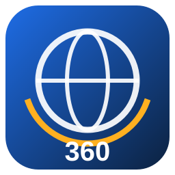

# OSV360Craft — Windows Edition



**Free • Open Source • MIT License**

OSV360Craft is a free, open-source Windows application that stitches original **DJI Osmo 360 `.OSV`** recordings into 360-degree equirectangular video. It does two things:

- **Live Stitching.** Open an `.OSV` and look around the stitched sphere straight away, with no export.
- **Batch Stitching.** Stitch whole cards or folders into validated 360° video, 8K included.

Stitching is done by the open-source [OpenOSV](https://github.com/Kemerd/OpenOSV) engine (Apache-2.0). It handles lens calibration, per-clip lens alignment, a parallax-aware carved seam, sky seam and lens-shading correction, sun-ghost removal and gyro stabilisation. OSV360Craft adds:

- **Hardware detection.** It checks this PC, tests every encoder for real, and picks the fastest settings that actually work here.
- **A pure-stitch pipeline.** Colour and 10-bit precision are kept.
- **Output validation.** Every file is checked before it is reported as done.

> OSV360Craft and OpenOSV are independent projects. They are not affiliated with, endorsed by or sponsored by DJI. DJI, Osmo and Osmo 360 are trademarks of SZ DJI Technology Co., Ltd.

## Latest release

Download **OSV360Craft 1.0.0 for Windows** from [GitHub Releases](https://github.com/PitKub/OSV360Craft/releases/latest).

## Download and run

From [GitHub Releases](https://github.com/PitKub/OSV360Craft/releases), download one of these:

- **OSV360Craft-1.0.0-Setup.exe** (recommended). This is a Windows installer with an **Express setup** that includes the OpenOSV engine and FFmpeg.
  - It asks whether to install for you only or for all users:
    - **For you only:** no administrator rights needed; default folder `%LOCALAPPDATA%\Programs\OSV360Craft`.
    - **For all users:** default folder `C:\Program Files\OSV360Craft`.
  - You can choose a different folder.
  - **Custom setup** lets you leave OpenOSV or FFmpeg out if you already have them.
  - It adds OSV360Craft to the Start menu, optionally to the desktop, and to **Settings → Apps** for uninstalling.
- **OSV360Craft-1.0.0-Windows-portable.zip.** The portable version: an `OSV360Craft` folder with the same engine and encoder in its `external` folder. Extract the whole ZIP and run `OSV360Craft\OSV360Craft.exe`. Keep the files in the folder together.

**Requirements**

- Windows 10 or 11, 64-bit.
- The **Microsoft Visual C++ 2015-2022 Redistributable (x64)**, which OpenOSV needs. Most PCs already have it. The installer checks for it and offers to open Microsoft's download page, and the Hardware Analyzer shows whether it is present.
- A GPU makes stitching much faster: CUDA on NVIDIA GTX 16 / RTX 20 and newer, OpenCL on AMD and Intel. Without one, the CPU renders, which is slow at 8K.

Windows SmartScreen may warn about a new, unsigned app. If you downloaded it from this repository, select **More info → Run anyway**.

**Antivirus warnings.** New, unsigned apps are sometimes flagged by antivirus *machine-learning* checks (names ending in `!ml`, for example `Trojan:Win32/Bearfoos.A!ml`). An early test build did trigger this, because it was a single self-extracting EXE. OSV360Craft is now built as a normal program folder that unpacks nothing to `%TEMP%`, and it never starts PowerShell. If you still see a warning:

1. Check that you downloaded OSV360Craft from this repository's Releases page.
2. Check the file on [VirusTotal](https://www.virustotal.com).
3. Report a false detection to Microsoft at <https://www.microsoft.com/en-us/wdsi/filesubmission>.
4. Open an issue here.

Never turn your antivirus off to run any app. On a work computer, ask your IT or security team first.

## Features

- **Live Stitching.** Opens original `.OSV` files and shows real OpenOSV stitches:
  - an interactive 360° viewer (pan, tilt, zoom, roll) and a flat panorama view;
  - timeline, playback and frame stepping;
  - a horizon guide and the two source lenses side by side;
  - live playback, stitching, decoding and GPU figures;
  - preview modes Native, 4K, 2K and Performance. The preview never changes the export.
- **Batch Stitching.**
  - **Adding clips:** files, folders with subfolders, or drag and drop. Proxies, empty files and duplicates are skipped.
  - **Queue:** reorder, pause after the current clip, stop, retry failed clips, and resume after a restart.
  - **Progress:** per-clip and overall progress with real speed and time left.
  - **Output:** organised project folders, and existing outputs are never overwritten silently.
- **Horizon, levelling and direction.** The DJI-Studio-style modes come from the camera's gyroscope: Horizon levelling, Direction lock, RockSteady and RockSteady + horizon, or Off. You can also set an **initial viewing direction**, which is written losslessly as 360 metadata.
- **Pure stitch by default.**
  - **Colour:** D-Log M stays D-Log M, HLG stays HLG, Rec.709 stays Rec.709.
  - **Precision and size:** 10-bit end to end, native resolution and source frame rate. Nothing is interpolated.
  - **Audio:** the original audio is copied, not re-encoded.
  - **Encoding:** HEVC 10-bit at CRF 16 (visually lossless).
- **Colour options when you want them.**
  - DJI-style or neutral Rec.709.
  - Rec.2100 PQ (HDR10) or HLG, with OpenOSV's tone scales and PQ peak brightness.
- **Formats.**
  - H.265/HEVC 10-bit, encoded directly by OpenOSV.
  - H.264 High 10 and ProRes 422 HQ.
  - 16-bit TIFF image sequence (uncompressed).
- **Validation of every output.**
  - Picture: resolution, 2:1 aspect, bit depth, frame rate, frame count and colour tags.
  - Audio: audio present and A/V sync.
  - 360 metadata: **Spherical Video V1 and V2**, checked by an independent parser and by ffprobe.
  - A decode test.
- **Intelligent hardware use.** It detects:
  - CPU, RAM and drives;
  - every GPU, with its VRAM, driver and CUDA compute capability;
  - OpenOSV's CUDA/OpenCL backends;
  - which encoders really work (NVENC, AMF, Quick Sync, x265) and whether they support HEVC Main10.

  **AUTO**, **QUALITY** and **PERFORMANCE** profiles are built from those results. An optional short benchmark uses one of your own clips. If a GPU fails at start-up, the next renderer is tried automatically and the reason is logged.
- Dark and Light themes, User Guide, Donate and About dialogs.

## Why D-Log M takes a little longer

OpenOSV writes only Rec.709, PQ or HLG directly to video. To keep your D-Log M untouched, OSV360Craft does the following:

1. OpenOSV writes the stitched frames as lossless 16-bit TIFF in small chunks.
2. FFmpeg encodes each chunk to 10-bit HEVC.
3. The chunks are joined without re-encoding, and the original audio is copied in.

Temporary chunks are deleted as the job goes, but it needs some extra free space while it runs.

## What changes in the picture — and what doesn't

Two things change, and both are unavoidable:

- Stitching **resamples** the two fisheye images into one sphere.
- A video file is **compressed** (CRF 16 by default, CRF 10 with *Maximum*).

OpenOSV works in 16-bit or 32-bit floating point between decoding and encoding. Everything else is kept unless you choose otherwise: colour, bit depth, frame rate and audio. For an uncompressed result, choose the 16-bit TIFF sequence. Native resolution is 2 × the lens height: **7680 × 3840 for 8K recordings** and 6000 × 3000 for 6K. A larger size is labelled as upscaled.

## Basic workflow

1. Start OSV360Craft. It detects your hardware and tools. This takes a few seconds while each encoder is tested.
2. Optionally run the benchmark in **Hardware Analyzer**.
3. Choose orientation in **Stitching Controls**, for example *Horizon levelling* or *Direction lock*.
4. Check **Export Settings**. The defaults are a pure stitch.
5. Open a clip in **Live Stitching** to look around, or go to **Batch Stitching**, add clips, choose a project folder and press **Start**.

Output layout:

```text
<Project folder>/
  Stitched/   finished, validated videos
  Reports/    one JSON validation report per job
  Logs/       the engine's own log per job
  Audio/      optional copy of the camera's audio track
  Preview/
  Original/   sources.json - a list of the originals, which stay where they are (never copied, moved or modified)
```

## Live preview: what to expect

Live Stitching has two kinds of preview. The preview never changes the export.

- **Real-time (camera proxy, quick stitch).** This is the default when it is possible.
  - **Source:** the Osmo 360 records a small `.LRF` proxy (2048 × 1024, both lenses) beside every `.OSV`. OSV360Craft plays that proxy in real time. If only the `.OSV` was copied, it decodes the `.OSV`'s two lenses on the GPU (NVDEC) and scales them down on the fly.
  - **Stitching:** the graphics card projects the lenses onto the sphere with OpenOSV's own lens calibration, read from the clip.
  - **Levelling:** the camera's gyroscope levels the view the same way OpenOSV does, using the stabilisation chosen in Stitching Controls.
  - **Nothing is written to disk:** no proxy is created and nothing is cached.
  - **What is skipped:** this is a quick stitch, without OpenOSV's seam carving, sky correction or colour conversion.
- **Exact OpenOSV stitch.** When you pause or scrub, the quick frame is replaced by OpenOSV's full stitch of that frame, which takes a few seconds at 8K. The 2K, 4K, Native and Performance modes also play OpenOSV's exact stitch, but each burst of frames is a separate OpenOSV run, so they are slow at 8K.

**What it would take for the full stitch in real time.** OpenOSV has no public frame-by-frame interface; its C ABI is private to its Premiere plug-ins. Real-time full-quality stitching would need a companion program built against OpenOSV's libraries. See [docs/INTEGRATION_REPORT.md](docs/INTEGRATION_REPORT.md).

## Privacy

OSV360Craft works offline. It does not send your media, settings or usage data anywhere. The only network actions are the links under **Help** (Donate → Open PayPal, and the source-code link), which open a website in your browser.

## Run from source

```bat
git clone https://github.com/PitKub/OSV360Craft.git
cd OSV360Craft
python -m pip install -r requirements.txt
powershell -ExecutionPolicy Bypass -File scripts\get_openosv.ps1
powershell -ExecutionPolicy Bypass -File scripts\get_ffmpeg.ps1
python main.py
```

When run from source, OSV360Craft finds the engine and encoder in `vendor\`. You can instead use the `external\OpenOSV\cli` and `external\ffmpeg` folders, or set the paths in **Settings**. Python 3.12 or newer, 64-bit.

## Build the EXE

Run `build.bat`. It does the following:

1. Installs the pinned build tools.
2. Compiles the program folder `dist\OSV360Craft\` (`OSV360Craft.exe` with its DLLs) with Nuitka in standalone mode.
3. Downloads the pinned, checksum-verified OpenOSV 0.6.4 and FFmpeg builds.
4. Makes the portable ZIP and, if Inno Setup 6 is installed, `dist\OSV360Craft-1.0.0-Setup.exe`.

See [docs/BUILDING.md](docs/BUILDING.md).

## Tests

```bat
python -m pip install -r requirements-dev.txt
python -m pytest -q
```

The suite runs every pipeline end to end, including D-Log M passthrough, H.264/ProRes, TIFF, GPU fallback, stop, validation failure and the preview engine. It uses a stand-in for osvtool that follows its documented command-line contract, together with real FFmpeg. Set `OSV360CRAFT_TEST_OSVTOOL` to a real `osvtool` to also check option compatibility and 360 tagging. [docs/TESTING.md](docs/TESTING.md) lists what has and has not been verified, including testing with real Osmo 360 footage.

## Project layout

```text
osv360craft/core/       OpenOSV discovery, clip probing, 360 metadata reader/editor
osv360craft/hardware/   CPU, GPU, RAM, storage and encoder detection, benchmark, AUTO/QUALITY/PERFORMANCE
osv360craft/export/     export settings -> osvtool commands, FFmpeg steps, output validation
osv360craft/batch/      persistent queue and the batch processor
osv360craft/live/       preview engine and the 360 viewer
osv360craft/ui/         PySide6 interface, themes, help
installer/              Inno Setup script
scripts/                pinned OpenOSV / FFmpeg downloads, icon
tests/                  pytest suite
docs/                   user guide, integration report, architecture, building, testing
```

## Contributing

Bug reports and pull requests are welcome. See [CONTRIBUTING.md](CONTRIBUTING.md). For a problem, attach the diagnostic bundle from **Logs and Diagnostics → Save diagnostic bundle**. It contains no media.

## License

OSV360Craft is released under the [MIT License](LICENSE). Copyright © 2026 Piotr Kubicki.

## Third-party software

- **Program folder:** includes Qt and PySide6 (LGPL-3.0) and the Python runtime.
- **Installer and portable ZIP:** include the **OpenOSV** engine (Apache-2.0, with its own third-party notices, including LGPL FFmpeg libraries) and **FFmpeg** (GPL-3.0). FFmpeg's source code is attached to every release.
- OpenOSV and FFmpeg are separate programs that OSV360Craft runs, so they do not change OSV360Craft's MIT licence.

See [THIRD_PARTY_NOTICES.md](THIRD_PARTY_NOTICES.md) and the `licenses` folder.

## Donations and contact

OSV360Craft is free to use. Donations are completely optional. If you enjoy the app and would like to support its continued development, choose **Help → Donate** and send a voluntary PayPal donation to **pitkub@gmail.com**. The dialog lets you copy the address or open PayPal.

For contact or support, email **pitkub@gmail.com**, or open an issue on GitHub.
